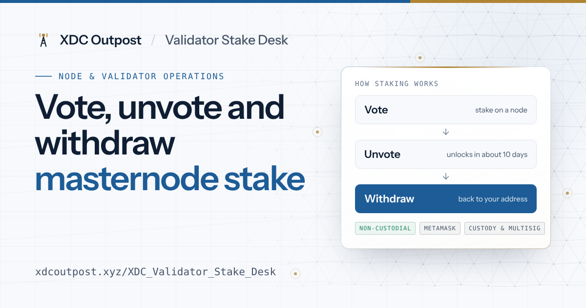

# XDC Validator Stake Desk

Vote, unvote and withdraw XDC masternode stake from your browser, with MetaMask or your custody platform. Part of [XDC Outpost](https://xdcoutpost.xyz/).

**Live:** https://xdcoutpost.xyz/XDC_Validator_Stake_Desk/

> **Status: in testing.** This page isn't ready for public use yet. Please don't use it with real funds. To try it, switch to the Apothem testnet under "Network and connection".

## What you can do

- **Vote:** stake XDC on a masternode candidate (at least 25,000 XDC per vote, top-ups included).
- **Unvote:** take stake back. It stays locked for the unlock period (432,000 blocks, about 10 days), then appears under Withdraw.
- **Withdraw:** claim unlocked stake back to your staking address.
- **Check a node:** see its total stake, rank, whether it's a masternode this epoch, and how much more stake it needs to become one.
- **Sign your way:** sign in MetaMask, or view an address held in a custody platform or multisig and get each transaction ready to sign there (destination, amount, call data, gas, or a JSON transaction).
- **Mainnet and Apothem testnet:** practise on the testnet first, with free TXDC from the [Apothem faucet](https://faucet.apothem.network/).

Minimums and the unlock period are read from the network, so the page always shows the current values.

## Your funds and keys

- Every transaction goes straight to XDC's built-in staking contract, `xdc0000000000000000000000000000000000000088`, the same contract the official XDC masternode dashboard uses.
- XDC Outpost never holds your funds or your keys. The page runs entirely in your browser.
- Each MetaMask transaction is checked against the network before MetaMask opens, so one that would fail is stopped with an explanation.
- The node's owner must keep the owner minimum (10,000,000 XDC) staked on it. Getting that back means resigning the node; stake from a resigned node unlocks after 1,296,000 blocks (about 30 days).

## Connection

Reads use the free public [Plugin XDC RPC](https://xdcoutpost.xyz/go/plugin-rpc/?from=stake-desk-readme) on mainnet and the public Apothem RPC on the testnet. You can switch to your own node or a private endpoint under "Network and connection". Your choice is remembered in your browser only.

## Licence

MIT. Provided as is, without warranty. Built and run independently; not operated by the XDC Foundation or XinFin.
